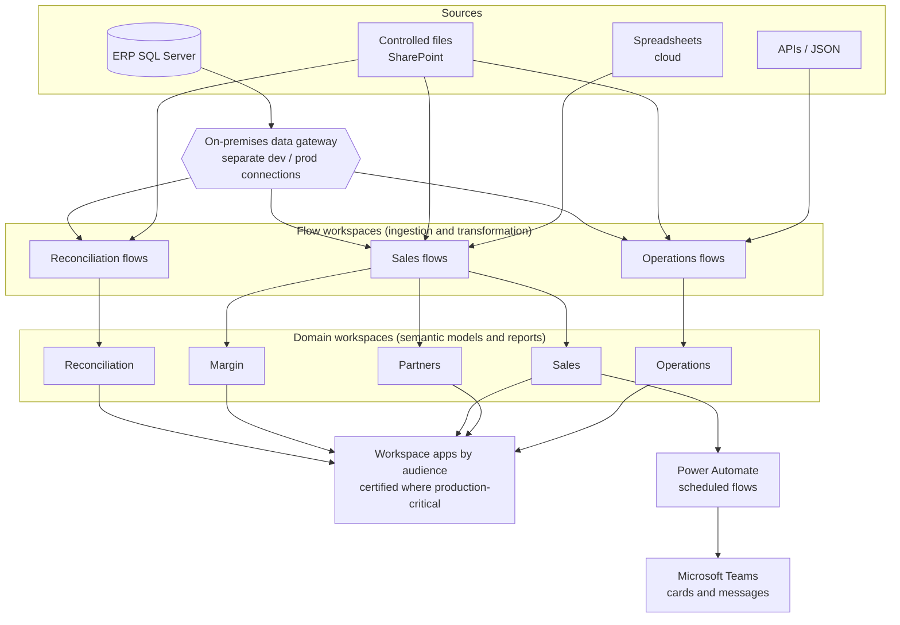
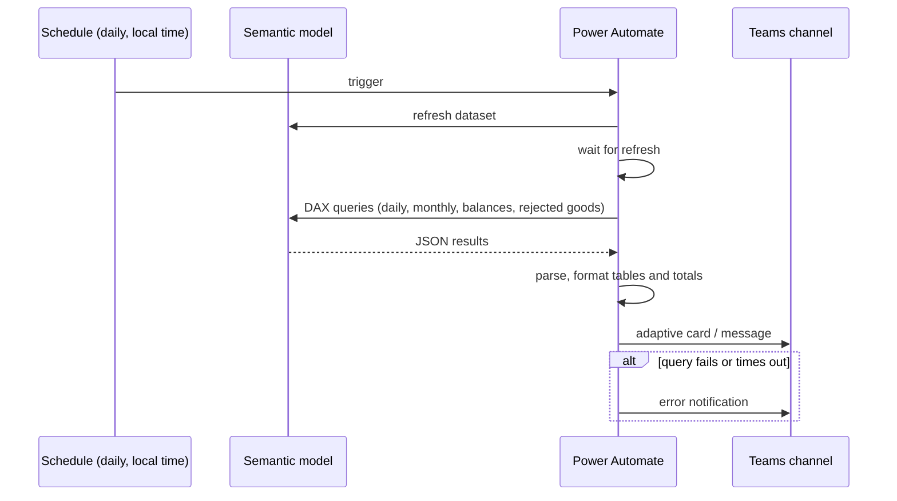

# BI Platform and Automation

🇧🇷 [Leia em português](README.pt-BR.md)

The platform behind the analytics: a layered **Microsoft Fabric / Power BI** environment (workspaces, dataflows, semantic models, apps, on-premises gateway) plus **Power Automate** flows that push daily insights to Microsoft Teams, with the standards that keep it maintainable.

> Everything here is **sanitized**. No tenant, server, workspace id, user, company or partner name appears in this repository.

## Architecture

- **Two kinds of workspace** – *flow* workspaces own ingestion and transformation (dataflows); *domain* workspaces own semantic models, reports and the App delivered to each audience. A heavy model never blocks a light one, and a source change touches one place.
- **On-premises gateway** – a gateway cluster serves SQL Server, SharePoint and dataflow connections. Development and production use separate connections, and access is granted to groups (administrators vs. the data team), not individuals.
- **Dataflows with Incremental Refresh** – large entities keep two years of history and refresh only the most recent months, detected by change.
- **Endorsement** – production-critical dataflows and the operations app carry the *Certified* label, so consumers know what to trust.
- **Monitoring** – the monitoring hub is used to follow scheduled refreshes, duration and failures across workspaces.
- **Migration path** – the reconciliation layer was rebuilt on Dataflow Gen2 in a test workspace while production keeps running on Gen1; rules moved into a config table so they can be versioned.

## Daily insights in Teams (Power Automate)

Two scheduled flows turn the semantic models into messages people actually read. Details in [`docs/power-automate-flows.md`](docs/power-automate-flows.md).

## Standards in use

Conventions that keep ~70 dataflows and dozens of models navigable. Details in [`docs/standards.md`](docs/standards.md).

- Numeric prefixes by layer (`0_` dimensions and estimates, `1_` origin, `2_` detail, `6_` finalized processes).
- `x_` marks retired items before removal; `TEST_` marks work in progress.
- Parameters in config tables, not buried in queries.
- A documented data dictionary and metric definitions per model.
- Incremental Refresh on large entities; certification for critical ones.

<!-- RESULTS: add measurable outcomes later (refresh time before/after, failures avoided, users, hours saved by automation). -->

## About

Built and maintained by [Bárbara Gomes](https://github.com/Barbarags) – Data & BI Coordinator.
